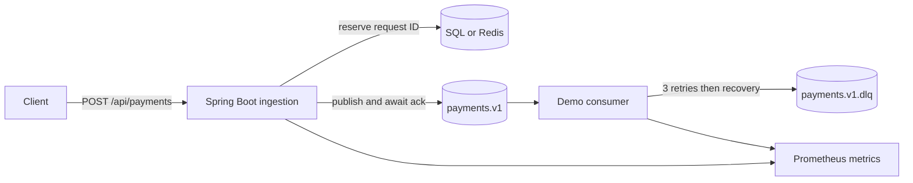

# Acknowledged Payment Ingestion — Java, Kafka, Failure Testing

A Java 17 / Spring Boot portfolio project exploring a precise question: **when can an asynchronous API honestly say a payment request has been accepted?**

The REST API waits for Kafka acknowledgement. SQL or Redis reserves request IDs; a demonstration consumer retries failed events and forwards them to a dead-letter topic. Tests, raw measurements, and design limitations are part of the project.

## Start reviewing here

- [Engineering case study](docs/ENGINEERING-CASE-STUDY.md): the original acknowledgement bug, regression test, tradeoffs, and remaining dual-write gap.
- [Evidence report](docs/EVIDENCE.md): executed checks and raw local measurements, with explicit scope.
- [Benchmark and profiling guide](docs/BENCHMARKS.md): repeatable commands, thresholds, environment capture, and interpretation.
- [Architecture](docs/ARCHITECTURE.md): service boundaries and failure semantics.

## What this demonstrates

| Engineering concern | Implementation / evidence |
| --- | --- |
| Honest asynchronous API contract | `ACCEPTED` follows the Kafka send future; failure/timeout becomes HTTP 503 |
| Concurrent request deduplication | SQL primary key; 32 concurrent attempts have one reservation winner |
| Failure handling | Delayed ack, broker error, timeout, interruption, store failure, context restart, retry and DLQ tests |
| Shared platform component | `platform-observability`: bounded operation/outcome tags and latency histograms across two services |
| Measurement discipline | Opt-in HTTP-to-Kafka smoke benchmark with raw samples; configurable k6 arrival-rate runner |
| Reviewable validation | Maven verification, per-module JaCoCo reports, Java 17/21 GitHub Actions workflow |



## Run the verification first

Requires JDK 17+ and Maven 3.9+. Integration tests use embedded Kafka and H2; Docker is not required.

```sh
mvn -B -ntp verify
mvn -B -ntp -Dportfolio.benchmark=true verify
```

Surefire reports are under each module's `target/surefire-reports`; coverage reports are under `target/site/jacoco`. The second command writes `payment-ingestion-service/target/evidence/local-smoke.json`. The CI workflow is supplied; a local passing run does not imply hosted CI has run.

## Run the services locally

### Windows demo without Docker

With Java, Maven and Node.js on PATH, run:

```powershell
.\scripts\start-local.ps1
# If Maven is portable, pass -Maven 'C:\path\to\mvn.cmd'
# After the first build, use -SkipBuild for faster startup.
```

Open `http://127.0.0.1:5173` for the dashboard and `http://127.0.0.1:8081/swagger-ui/index.html` for the API. The script starts an embedded Kafka broker, ingestion with in-memory H2, the processing consumer, the dashboard API and Vite. HTTP services bind to loopback. The demo Vite proxy routes directly to the services without the optional JWT gateway. This mode is for a local demonstration only; Kafka events and reservations reset when the demo restarts. Dashboard data remains synthetic.

Logs and process records are under `target/local-demo/`. Stop the processes with:

```powershell
.\scripts\stop-local.ps1
```

The original evidence report describes its saved source revision; the demo launcher was added afterward.

### Docker-backed development

The existing Compose file provides development Kafka, Redis and PostgreSQL. Docker and image availability must be checked on the target machine. This portfolio verification used embedded dependencies instead.

```sh
docker compose up -d
mvn -B -ntp install -DskipTests
```

In separate terminals:

```sh
mvn -pl payment-ingestion-service spring-boot:run "-Dspring-boot.run.arguments=--hvpps.idempotency.store=sql --spring.sql.init.mode=always"
mvn -pl payment-processing-service spring-boot:run
```

The SQL initialization flag is for the development database. Use reviewed migrations in a production design. Default Redis mode can instead be selected with `HVPPS_IDEMPOTENCY_STORE=redis`; it has a 24-hour reservation TTL. Datasource and Kafka settings are in each service's `application.yml`.

```sh
curl -X POST http://localhost:8081/api/payments -H "Content-Type: application/json" -d '{"requestId":"demo-001","accountId":"acct-1","amount":12.50,"currency":"USD","merchantId":"merchant-1"}'
```

- API schema: `http://localhost:8081/v3/api-docs`
- Actual metrics: `http://localhost:8081/actuator/prometheus` and port `8082`
- Retry/DLQ demonstration: send a new request with `merchantId` set to `FAIL`
- Sustained-load tooling: `python performance/run-benchmark.py --rate 100 --duration 2m` (requires k6)

These commands address ingestion directly in a local development environment. The optional gateway requires a configured JWT issuer. The existing auth service is a mock. Do not expose the development stack as a payment service.

## Precise limits

- This is an ingestion/reliability demonstration, **not a settlement engine**. The consumer does not debit accounts or write a ledger.
- Reservation and Kafka publication are not atomic. A crash can strand a reservation; a timeout can leave an unknown publication outcome. There is no automated reconciliation/outbox yet.
- `DUPLICATE` means a request ID is registered, not that its payment succeeded. Payload equality is not checked. Consumer exactly-once processing is not implemented.
- The dashboard's transactions, partition views and telemetry are **synthetic demo data**, not benchmark evidence. It is labeled accordingly.
- The k6 filename retains the original 1,000 TPS target; it defaults to 100 requests/second and does not establish achieved throughput. Short local measurements are not production capacity claims.
- Kubernetes manifests are examples; no GKE deployment or multi-node resilience is demonstrated here.

## Repository map

`payment-contracts` · `platform-observability` · `payment-ingestion-service` · `payment-processing-service` form the measured core. `api-gateway`, `auth-service`, `dashboard-service`, and `ui-dashboard` are supporting/demo components. See the [presentation kit](docs/PORTFOLIO-PRESENTATION.md) for a short technical walkthrough.
