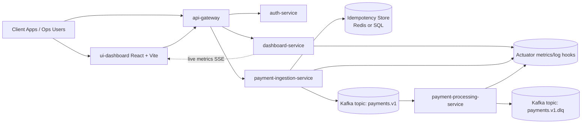
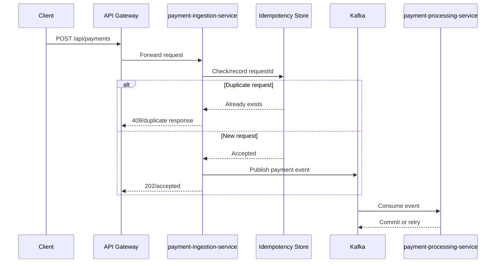
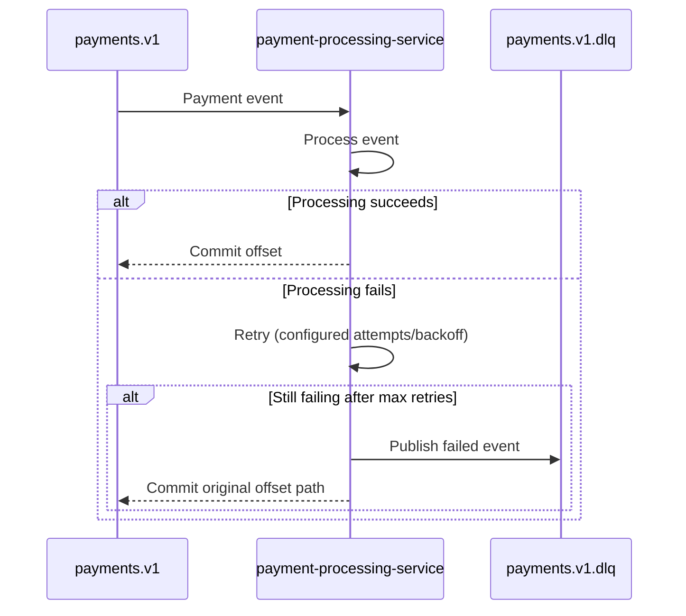
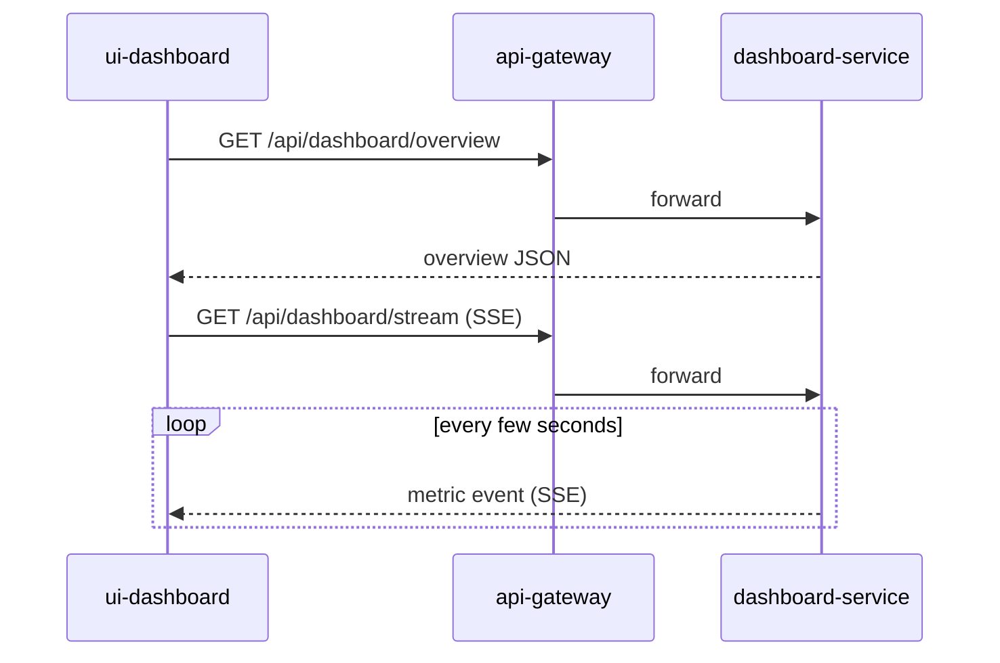

# PayDash - Complete Technical Documentation

This document provides a complete technical view of the High-Volume Payment Processing System (PayDash), including architecture, service responsibilities, request/data flows, runtime setup, reliability patterns, and operations guidance.

## 1) System Purpose

PayDash is a high-throughput payment platform designed to support 1,000+ TPS by splitting:

- **Synchronous edge traffic** (REST APIs for client ingestion and dashboard reads)
- **Asynchronous processing** (Kafka pipeline for scalable payment processing)

This keeps client response latency low while allowing horizontal scale and resilient background processing.

## 2) Technology Stack

### Backend

- Java 17
- Spring Boot 3.3.4
- Spring Cloud Gateway
- Spring Security (OAuth2/JWT style resource-server edge enforcement)
- Spring Kafka
- Spring JDBC
- Spring Data Redis
- SpringDoc OpenAPI 3 + Swagger UI

### Frontend

- React
- Vite
- CSS variables (light/dark dual-tone theming)
- Server-Sent Events (SSE) client + polling

### Data, Messaging, and Infra

- Apache Kafka
- Redis (default idempotency)
- PostgreSQL / Cloud SQL compatible JDBC mode
- Docker Compose (local Kafka + Redis + Postgres)
- Kubernetes/GKE deployment target

### Quality and Performance

- JUnit 5
- Embedded Kafka integration tests
- H2 integration tests for restart-safe behavior
- k6 load testing (1,000 TPS script)

## 3) Repository Structure

- `api-gateway` - Entry gateway and route/security layer
- `auth-service` - Authentication flows (username/password, OAuth mock, OTP mock)
- `dashboard-service` - Dashboard APIs, telemetry, transaction snapshots
- `payment-contracts` - Shared DTOs/events/contracts
- `payment-ingestion-service` - Payment REST ingestion, idempotency check, Kafka publish
- `payment-processing-service` - Kafka consumer with retry and DLQ behavior
- `ui-dashboard` - PayDash React web UI
- `performance` - k6 load scripts
- `k8s` - Kubernetes manifests

## 4) High-Level Architecture Diagram



## 5) Service Responsibilities

## `api-gateway`

- Single entry point for UI and external API consumers
- Route forwarding to internal services
- Security boundary for token validation and route-level controls

## `payment-ingestion-service`

- Accepts payment requests (`POST /api/payments`)
- Validates payload contracts
- Enforces idempotency (Redis or SQL mode)
- Publishes accepted requests/events to Kafka (`payments.v1`)
- Exposes OpenAPI docs and Swagger UI

## `payment-processing-service`

- Consumes payment events from Kafka
- Executes asynchronous business processing
- Retries transient failures
- Moves irrecoverable events to DLQ topic (`payments.v1.dlq`)

## `dashboard-service`

- Serves dashboard data: overview, transactions, partitions, failures
- Serves transaction detail API
- Provides live metrics via SSE
- Provides telemetry series for second/minute/hour/day/month/year/decade ranges

## `auth-service`

- Username/password login flow (mocked baseline)
- Google/GitHub login flow (mocked baseline)
- OTP send/verify flow for phone login (mocked baseline)

## `ui-dashboard`

- Displays operational metrics, transaction streams, and drill-down details
- Live updates through SSE and periodic refresh
- Dual-theme toggle with persisted preference

## 6) Core Runtime Flows

### 6.1 Payment Ingestion and Async Processing



### 6.2 Retry and DLQ



### 6.3 Dashboard Live Updates



## 7) Data and Contract Model

### Ingestion request contract (`payment-contracts`)

- `requestId` (idempotency key)
- `accountId`
- `amount`
- `currency`
- `merchantId`

Validation annotations enforce field shape and minimum amount before processing.

### Dashboard transaction model

- Transaction list item (table view)
- Transaction detail (drill-down view)
- Timeline events for each transaction
- Recent + cataloged transaction views

## 8) Reliability and Safety Patterns

- **Idempotency:** prevents duplicate payment acceptance by `requestId`
- **Retry + DLQ:** isolates poison messages and keeps consumer progress healthy
- **Async decoupling:** ingestion stays responsive while processing scales independently
- **Health/telemetry views:** dashboard gives near real-time operational visibility

## 9) Security Model (Current State)

- Gateway-centric security design
- Allowed local dev routes configured for easier UI iteration
- Intended production model: JWT/OAuth2 validation at edge, least-privilege service access

## 10) Local Development Setup

1. Start infra:

```bash
docker compose up -d
```

2. Build modules:

```bash
mvn clean package
```

3. Run services:

```bash
mvn -pl api-gateway spring-boot:run
mvn -pl dashboard-service spring-boot:run
mvn -pl payment-ingestion-service spring-boot:run
mvn -pl payment-processing-service spring-boot:run
```

4. Run UI:

```bash
cd ui-dashboard
npm install
npm run dev -- --port 5173
```

5. Open:

- `http://localhost:5173`

## 11) API Surface (Important Endpoints)

### Ingestion

- `POST /api/payments`
- `GET /v3/api-docs`
- `GET /swagger-ui.html`

### Dashboard

- `GET /api/dashboard/overview`
- `GET /api/dashboard/transactions`
- `GET /api/dashboard/transactions/catalog`
- `GET /api/dashboard/transactions/{transactionId}`
- `GET /api/dashboard/kafka/partitions`
- `GET /api/dashboard/failed`
- `GET /api/dashboard/telemetry?range=<second|minute|hour|day|month|year|decade>`
- `GET /api/dashboard/stream` (SSE)

## 12) Testing and Validation

- Duplicate request behavior across restarts
- Retry-to-DLQ path validation
- OpenAPI smoke checks
- k6 load script for high TPS behavior

## 13) Deployment Target (GCP)

- **Kubernetes runtime:** GKE
- **Container registry:** Artifact Registry
- **Managed SQL option:** Cloud SQL (PostgreSQL)
- **Monitoring/logging:** Cloud Monitoring + Cloud Logging
- **Secrets:** Secret Manager

## 14) Known Current Gaps / Next Hardening Steps

- Replace mock dashboard/auth data with production-backed stores
- Add distributed tracing (OpenTelemetry + correlation IDs)
- Add schema registry and stricter event versioning governance
- Add autoscaling policies and SLO-based alerting
- Strengthen auth flows from mock mode to full provider integration

